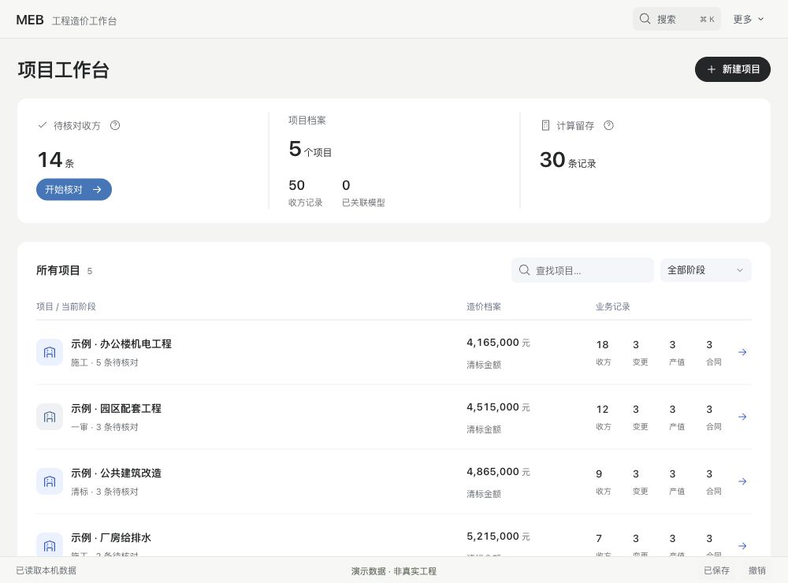
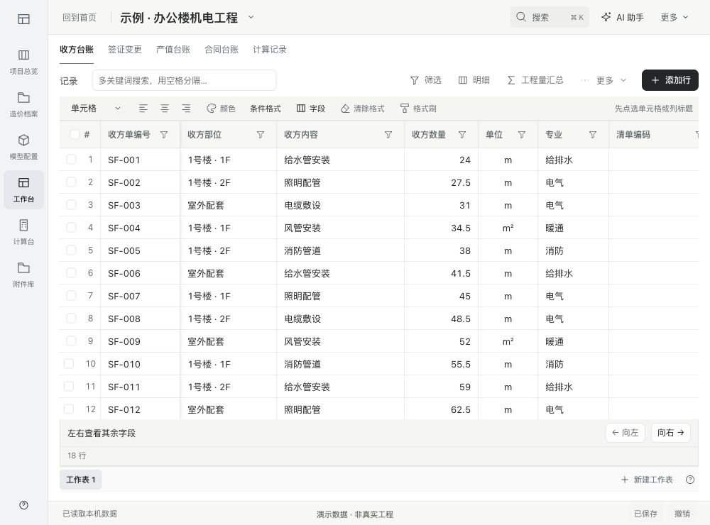
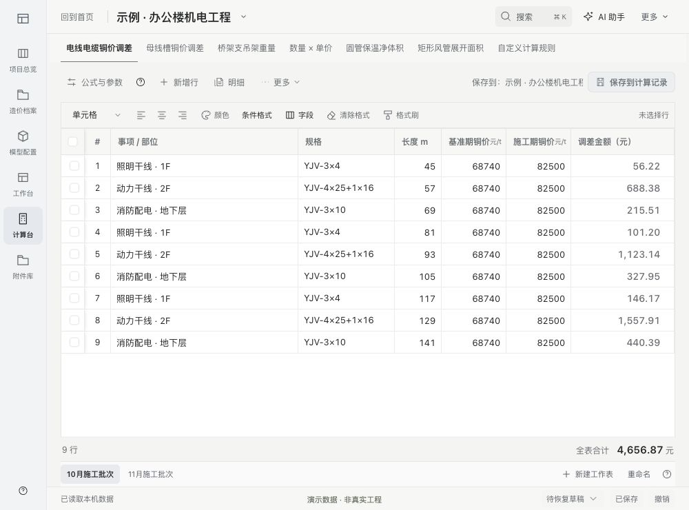
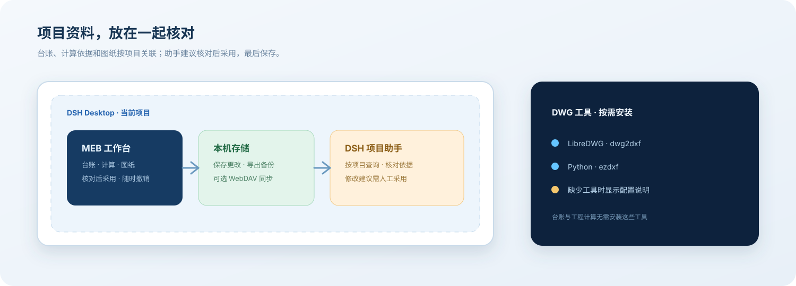

# MEB-DSH

<div align="center">

### 工程造价人的 DSH 工作台

台账、计算、图纸与项目助手，在同一个项目里核对。

<p>
  <a href="https://www.npmjs.com/package/meb-workbench"></a>
  <a href="https://github.com/baiye1997/MEB-DSH/blob/main/LICENSE"></a>
  <a href="https://github.com/baiye1997/MEB-DSH/actions/workflows/verify.yml"></a>
</p>

<p>
  <a href="#安装">安装</a> ·
  <a href="#快速上手">快速上手</a> ·
  <a href="https://github.com/baiye1997/MEB-DSH/blob/main/docs/usage.md">使用手册</a> ·
  <a href="https://www.npmjs.com/package/meb-workbench?activeTab=versions">npm 版本</a> ·
  <a href="https://github.com/baiye1997/MEB-DSH/issues">问题反馈</a>
</p>

</div>

<p align="center">
  
</p>

MEB 是运行在 [DeepSeek Harness](https://github.com/deepseek-ai/deepseek-harness) 桌面端的工程造价工作台。按项目整理台账、保留计算依据，对照 CAD 图纸核对数量，再让 DSH 助手基于当前项目继续工作。

## 能做什么

| 工作 | 功能 |
| --- | --- |
| 项目台账 | 收方、签证变更、产值、合同与材料价格管理 |
| 表格处理 | 区域拖选、批量颜色、清除格式、格式刷、条件格式与字段管理；Excel 导入导出 |
| 工程计算 | 电缆、母线槽、支吊架、保温、风管与自定义规则；核对参数、公式与计算过程 |
| 图纸核对 | DWG 候选轮廓审阅、楼栋配置、拆分与三维体量预览 |
| 项目助手 | 按当前项目查询资料、核对证据、预览和采用修改建议 |
| 数据管理 | 保存、撤销、备份恢复，以及可选的 WebDAV 同步 |

## 界面预览

以下为当前源码候选版的实际截图，全部使用合成演示数据。npm 当前稳定版为 0.1.3；截图中的新版布局与表格功能尚未发布。首次安装为空工作区，不内置示例项目、模型或工程资料。

<p align="center">
  
</p>

<p align="center">
  
</p>

## 安装

需要先安装 DSH Desktop。默认没有插件市场也可以安装 MEB；使用发布包无需注册 npm 账号或自行构建。

1. 打开 DSH Desktop 的「添加插件」。
2. 输入下面的 npm 包名，确认来源与版本。
3. 点击「安装」，按 DSH 提示刷新或重启。
4. 从左侧打开 **MEB 工作台**。

```text
meb-workbench
```

<p align="center">
  
</p>

镜像源暂未同步时，可在「安装源」中选择 npm 官方源。需要固定版本时，输入 `meb-workbench@0.1.3`，已发布版本见 [npm 版本列表](https://www.npmjs.com/package/meb-workbench?activeTab=versions)。

<details>
<summary>其他安装来源：GitHub、下载包、本地源码</summary>

**GitHub 源码**：在「添加插件」中输入：

```text
github:baiye1997/MEB-DSH#main&path:workbench
```

`main` 指定分支，`path:workbench` 指定仓库中的插件目录。这是 [pnpm 支持的 Git 子目录写法](https://pnpm.io/package-sources#install-from-a-git-repository-combining-different-parameters)。源码安装会执行本仓库的 `prepare` 构建。若 pnpm 提示构建未获准，请检查来源，并只批准当前提交的 `meb-workbench` 构建；不要全局放开脚本。若当前 DSH 版本解析失败，使用 npm 包或本地构建。

**本地安装包**：在终端运行 `npm pack meb-workbench@0.1.3`，将生成的 `.tgz` 文件完整路径填入「添加插件」。安装仍需联网获取 JavaScript 依赖。

**本地源码**：按 [开发指南](CONTRIBUTING.md#本地构建) 安装依赖并构建，再将本地 `workbench` 目录的完整路径填入「添加插件」。不要填仓库根目录。

</details>

升级或回退前，先在「备份与设置」导出备份，再按 DSH 提示卸载旧版并安装目标版本。详见 [版本与回退](VERSIONING.md)。

## 快速上手

1. **打开项目**：首页默认不选项目。新建或点击项目后，左侧 Dock 才显示项目功能，上方可切换项目。没有图纸或三维模型也能开始记录。
2. **填写台账**：从左侧「工作台」选择业务台账，点击「添加行」。可逐格编辑、粘贴 Excel 区域，或在底部新建独立工作表。
3. **导入已有表格**：打开「更多 → 导入 Excel」，选择工作表、核对字段映射和预览，再追加到当前台账。
4. **核对计算与建议**：计算台可勾选非相邻行分别批量设置参数。AI 助手默认在右侧，可展开阅读；发送前核对项目及资料范围。
5. **保存结果**：点击「保存更改」。入账、采用助手建议、恢复备份都会先进入编辑区，可核对、撤销后再保存。

需要按筛选范围导出、查看计算依据、关联附件或设置同步，见 [使用手册](docs/usage.md)。

## DWG 识图（可选）

收方、签证、产值等业务记录和工程计算，安装插件后即可使用。**只有解析 DWG 图纸时，才需另外安装 LibreDWG（dwg2dxf）与 Python + ezdxf。**

缺少工具时，工作台会提示配置环境；插件不会自动修改系统环境。具体命令与检查方法见 [CAD 环境配置](docs/cad-setup.md)。

在项目「模型配置」导入图纸后，核对候选轮廓、图纸单位、标段、楼栋身份、坐标与层高，再生成模型并保存。二维图纸用于生成可编辑的建筑体量，不能替代完整原图或施工级 BIM。操作步骤见 [图纸与模型](docs/usage.md#图纸与模型)。

## 使用与数据

<p align="center">
  
</p>

- **先核对，再保存。** 助手建议需确认后才进入编辑区；可撤销，点击「保存更改」后才保存到项目。
- **数据保存在本机。** 项目、台账和模型由 DSH 保存；可导出备份。发送给 DSH 助手的资料会进入对应项目会话。
- **同步按需开启。** WebDAV 同步需自行配置，目前凭据存储仅支持 macOS。发生两端冲突时，需选择保留哪一端。
- **原文件自行保管。** 本机引用的原文件、绝对路径和 DSH 对话不进入 WebDAV 备份；换电脑后需重新定位原文件。

## 常见问题

| 情况 | 处理方法 |
| --- | --- |
| 安装后没有入口 | 按 DSH 提示刷新或重启，检查插件是否已启用；本地源码安装须先完成构建。 |
| 找不到包或新版本 | 切换 npm 官方源并核对包名、版本；网络失败时先确认 DSH 能访问所选安装源。 |
| 提示缺少 CAD 解析环境 | 按 [CAD 环境配置](docs/cad-setup.md) 安装工具，完全退出并重新打开 DSH。 |
| 保存时提示版本冲突 | 保留输入或导出草稿，重新载入已保存数据后核对；不要直接覆盖另一端的修改。 |
| 导出后找不到文件 | 查看操作完成提示中的文件路径；导出由 DSH 写入本机数据目录。 |

## 源码与贡献

欢迎通过 [Issues](https://github.com/baiye1997/MEB-DSH/issues) 反馈问题，或提交 Pull Request。源码构建和提交前检查见 [开发指南](CONTRIBUTING.md)。反馈时请遮盖凭据和真实业务数据。

## 开源协议与致谢

项目使用 [MIT 开源协议](LICENSE)。第三方组件、字体及其许可证见 [第三方声明](THIRD-PARTY-NOTICES.md)，保留各自的版权与许可。
